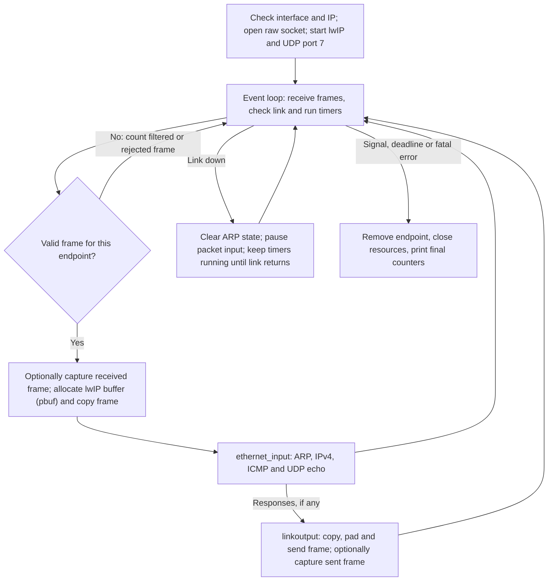
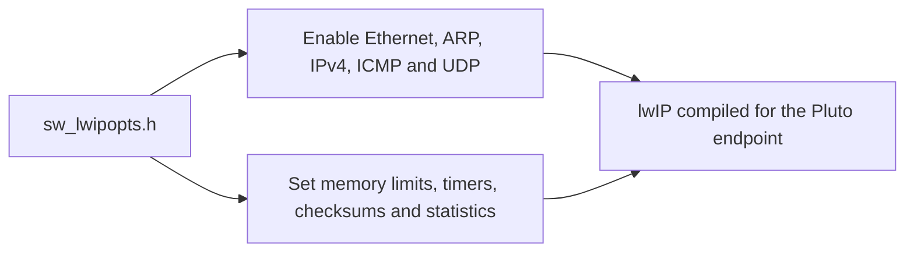
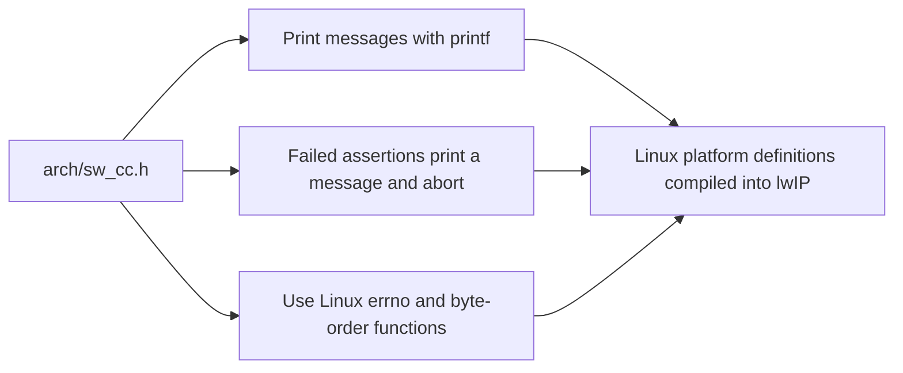
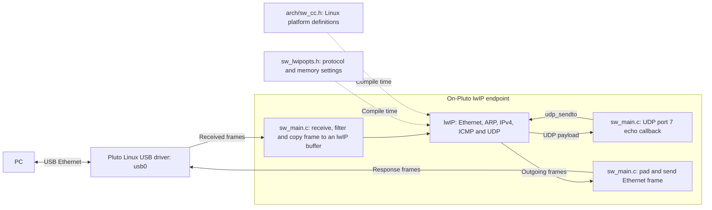

# M1 Progress and General Cleanup of Repo

Adds an lwIP endpoint on each Pluto's USB Ethernet connection. It has its own IPv4 address, resolves addresses with ARP, answers ping and echoes UDP data on port 7.

Linux supplies the USB driver. The application runs lwIP in one event loop, with fixed memory limits, checksum checks and link recovery.

Project files now use team prefixes. The filename check runs on pushes and pull requests. The issue guide lists tasks in project work order.

## Files included

- The production Ethernet application and its build script.
- The reusable network tester, filename checker and their tests.
- Setup instructions, source references and project planning documents.
- Git settings and the filename-check workflow.

One-off lab scripts, the earlier compatibility probe, saved logs and results, build manifests, evidence-folder settings and review-generation files stay local.

## Issue status

The Linux USB checks passed on both Plutos using one PC with two adapters. The issues are listed in work order and remain open because their full requirements are not yet met.

| Issue | Finished work | Still open |
|---|---|---|
| [#3 Reproducible builds](https://github.com/le21-j/wireless-beamforming-network/issues/3) | Pinned M1 lwIP release and compatible-compiler build instructions. | Complete FPGA and board-support tool versions, plus a teammate's build from a clean checkout. |
| [#6 Startup and timers](https://github.com/le21-j/wireless-beamforming-network/issues/6) | Linux boot and build identifiers, plus timer checks. | Board support, a bare-metal runtime or real-time operating system, and interrupt checks. |
| [#8 Host checks and reports](https://github.com/le21-j/wireless-beamforming-network/issues/8) | Traffic generation, payload checks and pass/fail reports. | Firewall records and routes to the remote network, including cleanup. |
| [#11 Ethernet and lwIP](https://github.com/le21-j/wireless-beamforming-network/issues/11) | Linux USB endpoint, fixed addresses, timers, checksums and memory and error counters. | Vendor `eth0` driver and board support, physical-link speed and cable reconnect. |
| [#17 PC-to-Pluto checks](https://github.com/le21-j/wireless-beamforming-network/issues/17) | Ping and unchanged UDP payloads on both Plutos, repeated after reboot and application restart. | Two-PC setup, original board support and serial-log requirements, or agreed replacements. |

## Pluto software

| File | Purpose |
|---|---|
| `firmware/net/lwip_ethernet/sw_main.c` | Receives Ethernet frames, passes them to lwIP and sends replies. Handles link changes and keeps timers running. |
| `firmware/net/lwip_ethernet/sw_lwipopts.h` | Sets the protocols, memory limits, checksums and counters for the Pluto endpoint. |
| `firmware/net/lwip_ethernet/arch/sw_cc.h` | Connects lwIP messages, failed assertions, errno and byte-order functions to Linux. |

## File flows

### `firmware/net/lwip_ethernet/sw_main.c`

### `firmware/net/lwip_ethernet/sw_lwipopts.h`

### `firmware/net/lwip_ethernet/arch/sw_cc.h`

## M1 integration

## Bring-up and sources

- [Project work order](github-issues.md)
- [Build, run and test](../firmware/net/lwip_ethernet/README.md)
- [Team review](bringup/sw_m1_team_review.md)
- [Research](research/sw_lwip_pluto_compatibility.md)
- [SW resources](bringup/sw_resources.md)
